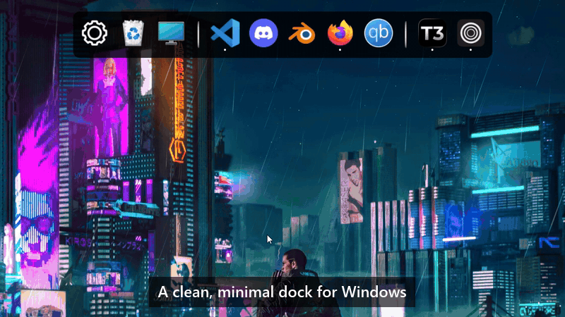
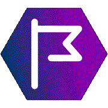
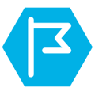

> Follow @TeiuAlligator on X to stay tuned for new features and updates!

> ## How To Install
> 1. Go to [Releases](https://github.com/arthurdeka/cedro-modern-dock/releases):
> 2. Download the latest `CedroModernDock-1.2.0-x64.msi` file
> 3. Execute and install
 

## Special Thanks 💖

<table>
  <tr>
    <td>
      
      
    </td>
    <td valign="middle">
      Free code signing provided by <a href="https://about.signpath.io">SignPath.io</a>, certificate by <a href="https://signpath.org">SignPath Foundation</a>.
    </td>
  </tr>
</table>
 

## What's new in v1.3

- **Dock themes:** Change the whole look of the dock in one click with 11 built-in themes, or install third-party themes from `.cedrotheme`/`.zip` packages. Want to make your own? See the [theme guide](docs/THEMES.md).
- **Edit the dock right from the dock:** Right-click to add a program, folder or separator exactly where you clicked, rename items, change their location or remove them.
- **Drag and drop:** Drop programs, shortcuts and folders from the desktop or Explorer straight onto the dock, and drag pinned icons to reorder them.
- **Separators:** Group your shortcuts with dividers between items.
- **Lock dock icons:** Keep your layout safe from accidental drags; unlock it whenever you want to rearrange.
- **Discreet mode:** The idle dock gently fades and shrinks after a configurable delay and opacity, and wakes up as soon as you approach it.
- **Dock padding:** Adjust the space around your icons, and the hover zoom is no longer cut off by the dock edges.
- **Redesigned settings and menus:** A new settings window with sidebar navigation (including the language selector), plus rounded context menus with icons and new actions like opening a new window or closing all windows of an app.
- **Start Menu module:** Pin the Start Menu to your dock, with the Windows 11 icon.
- **Signed installer:** The installer is now code signed through SignPath Foundation.
- **Scaled displays:** The dock now stays correctly centered on displays with Windows scaling enabled.
 

## What's new in v1.2

- **Live window previews:** Hover a running app to see its open windows in real time, click one to bring it forward.
- **Running apps you haven't pinned:** Apps currently open but not pinned show up on the dock now.
- **Customize your icons:** iOS-style color tint with 12 presets or pick your own color.
- **Drag to reorder:** Now you can rearrange your dock shortcuts right in the Settings list by dragging them around.
- **Vertical dock:** Arrange the dock vertically on either side of the screen.
- **Updates that keep your setup:** - Upgrading to a new version replaces the app but keeps your shortcuts and settings.
- **Long-awaited feature:** Now CTRL + D does NOT minimizes the Dock anymore. It remains on the Desktop.
 

## Supported Languages

- 🇺🇸  English
- 🇧🇷 Portuguese (Brazil)
- 🇪🇸 Spanish
- 🇫🇷 French
- 🇩🇪 German
- 🇯🇵 Japanese
- 🇨🇳 Chinese (Simplified)
- 🇹🇼 Chinese (Traditional)
- 🇮🇳 Hindi
- 🇸🇦 Arabic
- 🇧🇩 Bengali
- 🇷🇺 Russian
- 🇵🇰 Urdu
- 🇮🇩 Indonesian
- 🇳🇬 Nigerian Pidgin
- 🇮🇳 Marathi
- 🇮🇳 Telugu
- 🇹🇷 Turkish
- 🇮🇳 Tamil
- 🇭🇰 Cantonese
- 🇻🇳 Vietnamese
 

<!-- BUILT WITH -->
## Built With

* 
* 
 
